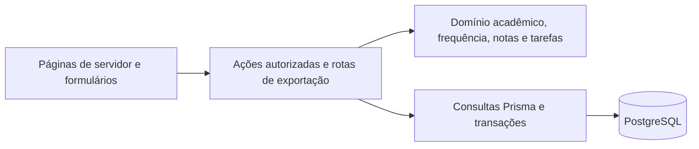

# Arquitetura

## Decisão: monólito modular

O CampusHub usa uma aplicação Next.js e um PostgreSQL. A organização acadêmica exige consistência transacional e operação local simples; serviços independentes e transações distribuídas acrescentariam custo sem necessidade comprovada. Os módulos concentram regras e casos de uso; o Next.js funciona como camada de entrega.

`src/modules/*/domain.ts` contém cálculos determinísticos sem dependência de armazenamento. Os arquivos `actions.ts` validam, autorizam, executam transações e invalidam a renderização. `queries.ts` reúne consultas reutilizáveis. Consultas pequenas nas páginas são modelos de leitura do servidor, não regras de domínio. `src/lib/server` concentra sessão, banco, transações e tratamento seguro de erros. Componentes interativos são ilhas de cliente; os demais priorizam renderização no servidor.

Os componentes em `src/components/ui` seguem o padrão de código próprio do shadcn/ui. Não existe uma dependência instalada chamada `shadcn`. Também não há interface genérica de repositório para um único banco, microsserviços ou backend separado.

## Identidade atual

A identidade disponível é uma sessão demo assinada, exclusivamente para desenvolvimento local, sem senha, cadastro público ou identidade de produção. Better Auth está planejado e não instalado. `requireUser()` concentra a fronteira a substituir quando a autenticação de produção for implementada. `User` guarda somente a identidade fictícia necessária; tabelas de contas, sessões e verificação de um provedor futuro não foram criadas.

## Modelo implementado

| Entidade | Responsabilidade |
| --- | --- |
| `Institution` | Referência à instituição; o seed contém PUC-Campinas, sem alegar afiliação. |
| `User` | Identidade de desenvolvimento e propriedade dos registros. |
| `SubjectDefinition` | Código e nome pessoais de uma disciplina em uma instituição, reutilizáveis entre períodos. |
| `AcademicTerm` | Rótulo de período informado pelo usuário, sem datas oficiais inventadas. |
| `ClassOffering` | Oferta de uma disciplina em um período para um usuário, com suas políticas v1. |
| `Absence` | Falta manual com data, quantidade e observação opcional. |
| `Assessment` | Componente de avaliação com peso e nota opcional. |
| `Task` | Tarefa manual com prazo por dia, status e vínculo opcional com oferta. |

A definição da disciplina é separada da oferta: períodos diferentes podem ter regras e registros distintos. Reutilizar o código pessoal reutiliza a definição; alterar seu nome também altera a identificação nos períodos anteriores. Todos os registros atuais são manuais. Integrações futuras deverão acrescentar procedência, identificadores externos e datas de consulta, mantendo registros oficiais separados de estimativas pessoais.

Chaves únicas compostas `(id, ownerId)` permitem que as chaves estrangeiras imponham o mesmo dono nos vínculos entre oferta, definição, período, falta, avaliação e tarefa. A aplicação fixa a instituição inicial nas alterações. Uma interface multi-instituição futura deverá também verificar a instituição entre definição/período e vínculos verificados; a referência atual não concede acesso a uma comunidade.

Excluir uma oferta remove suas faltas e avaliações em cascata. O caso de uso primeiro desvincula as tarefas na mesma transação. Definições e períodos são mantidos para reutilização; a tela de configurações pode excluir todos os dados acadêmicos do usuário. A exclusão completa de uma conta futura tem requisitos adicionais em [segurança](security.md).

## Cálculos e consistência

A frequência armazena quantidades em centésimos. Aulas exigem quantidades inteiras; horas aceitam incrementos de 0,01. Percentuais são pontos-base. A margem é arredondada para baixo na unidade permitida, evitando autorizar uma aula inteira com uma fração de tolerância. O percentual compara faltas com a carga total prevista. Margem zero indica atenção; ultrapassar o limite gera um estado distinto.

A regra de notas é estrita e versionada (`version: 1`, `kind: WEIGHTED`), com escala iniciada em zero, máximo, meta, precisão de apresentação e modo de arredondamento. Notas aceitam 0,0001 e pesos aceitam 0,01%. Os pesos devem somar exatamente 100% para calcular/exportar. O usuário pode salvar componentes intermediários inconsistentes durante a montagem; a interface deve explicar o erro. Não há fórmulas arbitrárias, `eval`, recuperação ou exame.

O motor usa produtos `bigint` e só arredonda as razões para apresentação. A aprovação usa a soma ponderada sem arredondamento. A média parcial normaliza os pesos preenchidos, e a final permanece ausente enquanto faltar nota. A nota comum necessária nas avaliações restantes usa arredondamento para cima em 0,0001 e distingue meta garantida, impossível e cenário concluído.

O XLSX normaliza notas e pesos em unidades inteiras antes de `SUMPRODUCT`; os limites de entrada mantêm as somas dentro da precisão inteira do formato numérico utilizado. Os resultados iniciais vêm do motor de domínio. Apenas notas são editáveis, com validação de escala/precisão. Proteção e validação da planilha não são controles de autorização. A recalculação em Excel/LibreOffice ainda precisa ser verificada manualmente.

Alterações dependentes de agregados usam transações serializáveis, com até duas novas tentativas em conflitos de serialização. Restrições `CHECK` rejeitam quantidades estruturalmente inválidas. Limites entre linhas continuam sendo invariantes dos casos de uso; futuros escritores devem respeitá-los. Consultas relacionais usam carregamento em lote, sem um loop de consulta por registro. Listas de ofertas/tarefas são paginadas; avaliações, faltas e seletores têm limites explícitos do MVP.

## Extensão futura

Os módulos puros de frequência e notas podem ser extraídos com seus testes e tipos de entrada. ExcelJS é um adaptador de exportação, não uma dependência do cálculo. Preserve essa separação de framework, banco e APIs externas; decisões de licenciamento ainda estão pendentes.

Campi, cursos, matrículas, catálogos oficiais e vínculos/roles verificados serão introduzidos com funcionalidades reais. Comunidade, biblioteca e navegação terão autorização e procedência próprias. Os [contratos de integração](integrations.md) não possuem implementação ativa.

## Dependências declaradas

`package.json`, `.nvmrc` e `compose.yaml` declaram Node 24, Next 16.4.2, React 19.3.1, Prisma 7.10.0 com adaptador PostgreSQL, PostgreSQL 17, Tailwind 4.3.3, TypeScript 5.9, Zod 4, ExcelJS 4.4, Vitest 4 e Playwright. O gerador Prisma produz TypeScript ESM em `src/generated/prisma`, ignorado pelo Git. Sem instalação/lockfile, essa lista verifica a intenção dos arquivos, não a resolução ou compatibilidade em execução.

A seleção inicial consultou documentação oficial: [Next.js](https://nextjs.org/docs/app/getting-started/installation), [PostgreSQL no Prisma](https://www.prisma.io/docs/orm/v7/core-concepts/supported-databases/postgresql), [geradores Prisma](https://www.prisma.io/docs/orm/v7/prisma-schema/overview/generators), [shadcn/ui](https://ui.shadcn.com/docs/installation/manual), [Zod](https://zod.dev/error-customization), [Vitest](https://vitest.dev/guide/) e [Better Auth](https://better-auth.com/docs/installation). As limitações de validação estão em [verification.md](verification.md).
